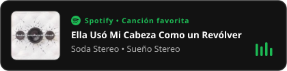

  

# Hola, soy Mario Osorio 

> *"Crea con el corazón; construye con la mente."*  
> — **Criss Jami**

---

### 👨‍💻 Sobre mí

Soy Mario, un estudiante de **Ingeniería Informática** curioso por naturaleza y que sigue tratando de comprender la vida.

Algunas de mis pasiones, más allá de la tecnología, son la **política**, la **literatura** y la **música**.

---

### 🛠️ Tecnologías y Herramientas

  
  
  
  
  

---

### 📖 Rincón de lectura

* 📚 **[Loqueleo](https://github.com/Maritoz/Loqueleo)** — Un repositorio personal recién creado donde escribo resúmenes y reflexiones sobre los libros que voy leyendo.
  * *Última entrada:* [🐖 George Orwell y los cerdos autoritarios](https://github.com/Maritoz/Loqueleo/blob/main/orwell_y_totalitarismo.md)

---

### 🎵 En mis auriculares

  

---

### 📈 Actividad y Contribuciones

  

---

### 📬 Contacto

  

---

  + <i>Antes de cambiar el mundo, primero cámbiate a ti.</i>

